# 米家 App（aa.apk）完整逆向文档

> 逆向对象：`aa.apk`（com.xiaomi.smarthome，**版本 11.7.709.5601-MI_APP_STORE**，244MB）
> 逆向方法：jadx 反编译 33101 个类 + 真机（小米 8 / Android 10）ADB 实机遍历截图
> 截图目录：`./screenshots/`（35 张，全部真机实拍）

---

## 1. App 概览

| 项 | 值 |
|---|---|
| 包名 | `com.xiaomi.smarthome` |
| 版本 | 11.7.709.5601-MI_APP_STORE |
| 主 Activity | `com.xiaomi.smarthome.SmartHomeMainActivity` |
| 启动流程 | CTAAuthorizationActivity（隐私同意）→ SelectServerActivity（服务器）→ 引导页 → SmartHomeMainActivity |
| Activity 总数 | 925 个（其中 com.xiaomi.smarthome 本体 682 个，完整清单见 `activities_list.txt`） |
| 技术形态 | 原生（Android 原生页面）+ 插件（设备控制页为 React Native / 小程序，**内容服务端下发**） |
| 加固 | assets/A3AEECD8.dex + libA3AEECD8.so（壳），classes2~14.dex 业务代码为明文 |

### 1.1 底部导航结构（4 Tab）

```
米家（首页）  |  智能（场景）  |  产品（商城发现）  |  我的
```

> 旧版有第 5 个「商城」Tab（11.11 活动），当前版本按运营开关动态隐藏。

---

## 2. 页面导航地图

```
启动 → 隐私同意(CTAAuthorizationActivity)
     → 服务器选择(SelectServerActivity)
     → 设计焕新引导页
     → 主界面 SmartHomeMainActivity
        ├─ [米家] 首页
        │    ├─ 家庭名⌄ → 家庭管理(CreateHouseActivity) → 家庭详情
        │    ├─ 房间Tab：全屋/客厅/卧室/厨房/阳台 + ≡房间列表弹层
        │    ├─ 顶部：智能助手 | 3D家居视图 | 消息中心 | +菜单
        │    ├─ 设备卡片 → 设备插件页(PluginRNActivity，服务端下发)
        │    └─ 编辑 → 房间编辑
        ├─ [智能] 场景页
        │    ├─ 探索 Tab（推荐场景/最新应用/日常生活）
        │    └─ 我的智能 Tab（手动控制 + 自动化）
        ├─ [产品] 商城发现页
        └─ [我的] 个人中心
             ├─ 家庭卡片 → 家庭管理
             ├─ 设备耗材/语音控制/家庭网络/中枢与网关/连接三方平台
             └─ 更多设置(AboutActivity) → 关于米家(AboutMijiaActivity)
```

---

## 3. 页面明细（截图 + 功能 + 接口）

### 3.1 启动链路

#### 隐私同意页（CTAAuthorizationActivity）

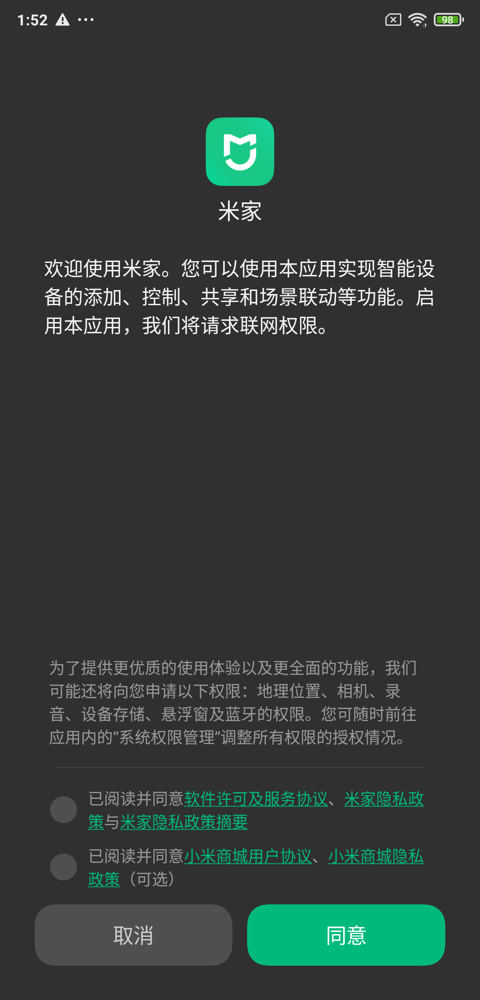

- 功能：软性许可及服务协议、米家隐私政策、小米商城协议勾选；「同意/取消」
- 进入方式：首启必经；同意后写本地标记不再弹出
- 接口：无（纯本地），同意后才初始化网络栈

#### 服务器选择（SelectServerActivity）

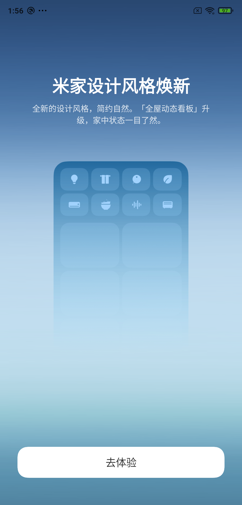

- 功能：选择数据服务器地区（中国大陆/…）
- 接口：决定后续所有 API 的域名前缀（见 §4.1）

#### 设计焕新引导页

（未单独截图，同 02 之后的滑动引导）

- 功能：「米家设计风格焕新」全屋动态看板介绍，「去体验」进入主界面

---

### 3.2 [米家] 首页（SmartHomeMainActivity）

#### 首页总览（全屋）

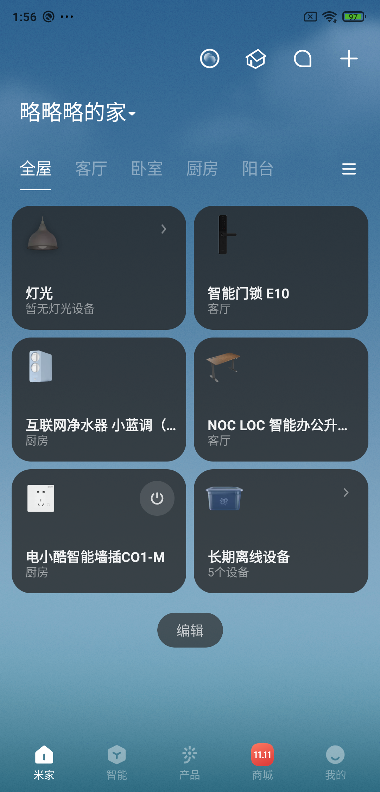

**页面结构（自上而下）：**

1. **顶部图标栏**（右上 4 个）：智能助手 | 3D家居视图 | 消息中心 | ＋菜单
2. **标题栏**：`略略略的家⌄`（家庭切换下拉）+ 天气（27°，点击有详情）
3. **房间 Tab**：全屋 | 客厅 | 卧室 | 厨房 | 阳台 | ≡
4. **设备卡片区**（2 列瀑布网格）：
   - 灯光聚合卡（无灯光设备时显示「暂无灯光设备」）
   - 设备卡：智能门锁 E10（客厅）、互联网净水器 小蓝调（厨房 · 纯水水质 94）、NOC LOC 智能办公升降桌（客厅）、电小酷智能墙插 C01-M（厨房）、长期离线设备（5个设备，聚合卡）
5. **编辑按钮**：进入房间编辑

**真实数据接口：**

| 数据 | 接口 |
|---|---|
| 设备列表 | `POST /v2/home/device_list_page`（响应顶层 `list` + `has_more`/`next_start_did` 分页） |
| 家庭/房间 | `POST /v2/homeroom/gethome_merged`（homelist/roomlist） |
| 天气 | 家庭经纬度 → 天气服务 |

#### 各房间 Tab

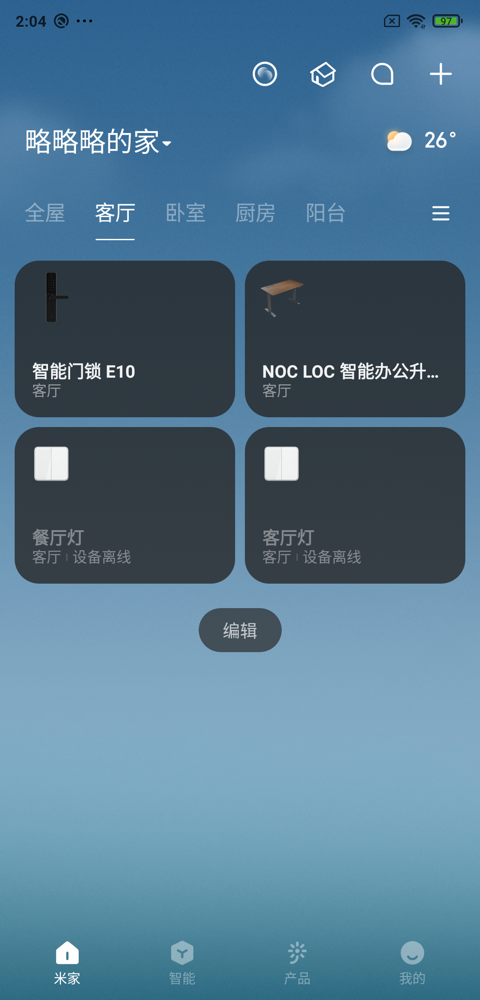
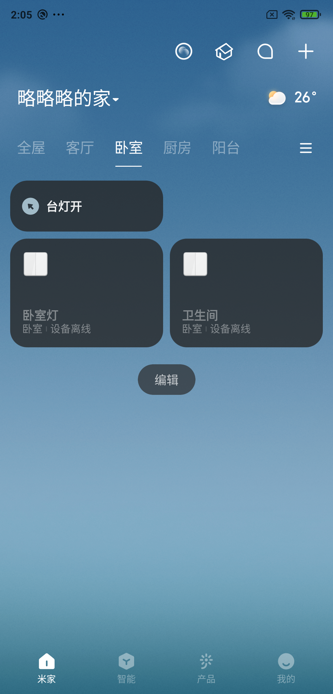
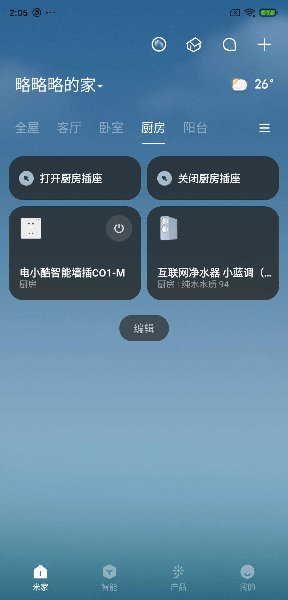
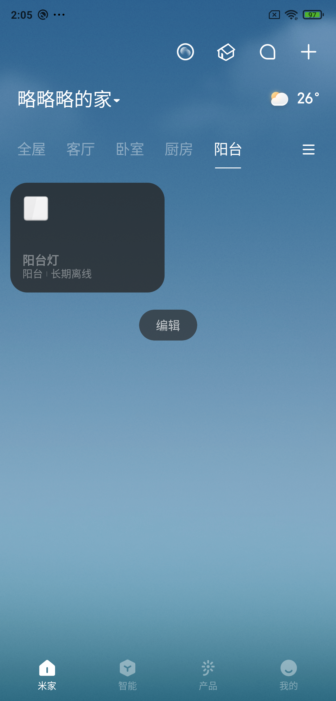

- **客厅**（4 设备）：智能门锁 E10、NOC LOC 智能办公升降桌、餐厅灯（设备离线）、客厅灯（设备离线）
- **卧室**（2 设备）：见截图
- **厨房**（2 设备 + 快捷场景）：顶部「打开厨房插座」「关闭厨房插座」快捷卡片（房间级场景，一键下发）、电小酷智能墙插 C01-M、互联网净水器 小蓝调
- **阳台**（1 设备）：阳台灯（长期离线）

> 规律：房间 Tab 的设备卡 = 该房间设备过滤；厨房页顶部的快捷开关是**房间绑定的手动场景**（`roomlist` 场景关联）。

#### ≡ 房间列表弹层

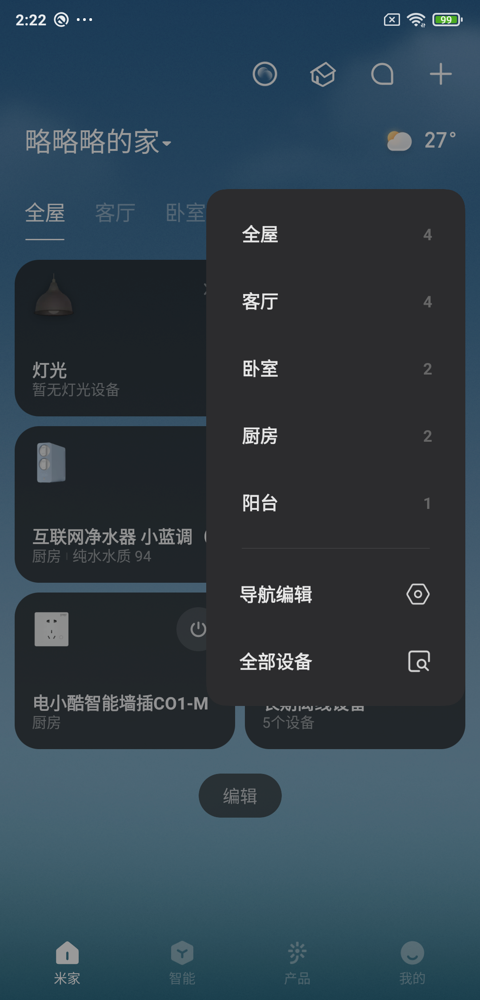

- 功能：全部房间（含设备数角标：全屋4 / 客厅4 / 卧室2 / 厨房2 / 阳台1）+ **导航编辑** + **全部设备**
- 接口：同首页设备列表；「全部设备」跳 `TVListActivity` 式的全量设备管理页

#### 房间编辑（编辑按钮）

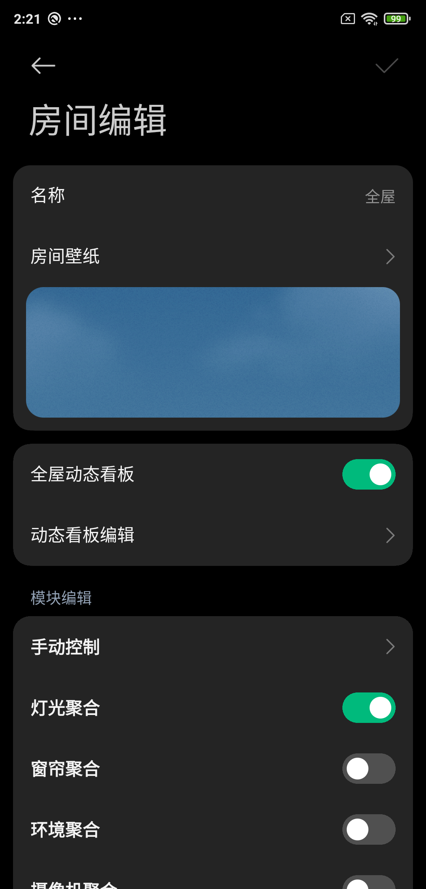

- 功能：
  - 名称（全屋）、房间壁纸（背景图，即首页蓝色天空背景）
  - **全屋动态看板**开关 + 动态看板编辑
  - **模块编辑**：手动控制 / 灯光聚合 / 窗帘聚合 / 环境聚合 / 摄像机聚合（各模块显隐开关）
- 对应 Activity：`com.xiaomi.smarthome.control.edit.EditControlCenterActivity`
- 接口：房间配置保存（homeroom 模块更新接口）

#### 顶部功能

**米家智能助手（@ 图标）**

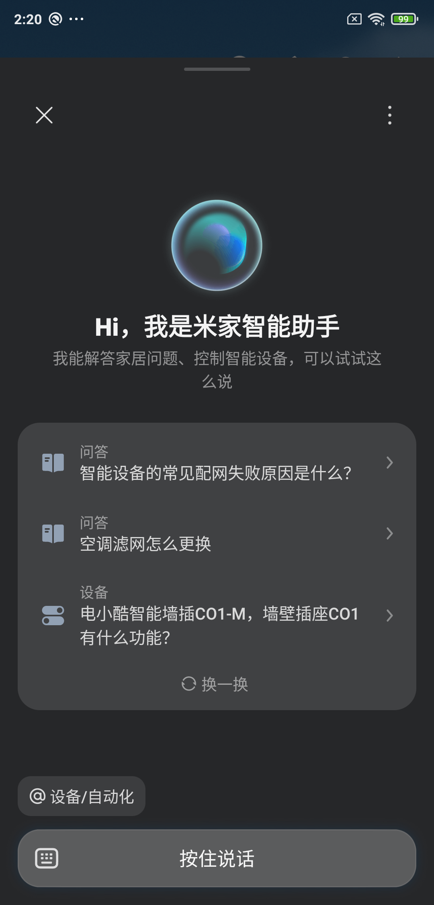

- 功能：AI 问答（「智能设备的常见配网失败原因是什么?」「空调滤网怎么更换」）、设备控制（「电小酷智能墙插C01-M，墙壁插座CO1有什么功能?」）、@设备/自动化引用、按住说话语音输入
- 接口：小爱/AI 对话服务（流式）

**3D 家居视图入口**

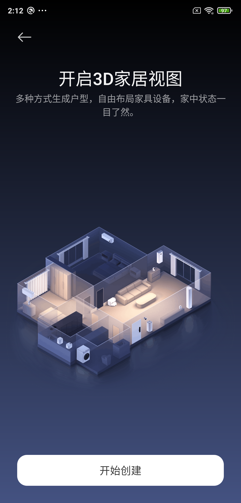

- 功能：「开启3D家居视图」——生成户型、自由布局家具设备（`House3dActivity` / `CreateHouseActivity`）

**消息中心**

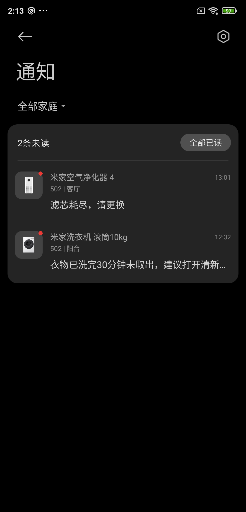

- 功能：按家庭筛选（全部家庭⌄）、未读管理（2条未读/全部已读）、设备消息卡（米家空气净化器4：滤芯耗尽请更换；米家洗衣机滚筒10kg：衣物洗完30分钟未取出）
- 对应 Activity：`com.xiaomi.smarthome.messagecenter.ui.MessageCenterV2Activity`
- 接口：消息列表（服务端推送 + 拉取）

**＋ 菜单**

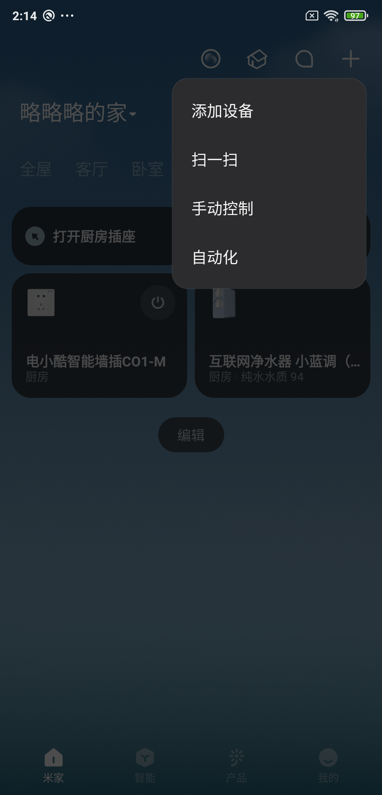

- 功能：添加设备 / 扫一扫 / 手动控制 / 自动化（四个入口）

#### 添加设备（ChooseDeviceActivity）

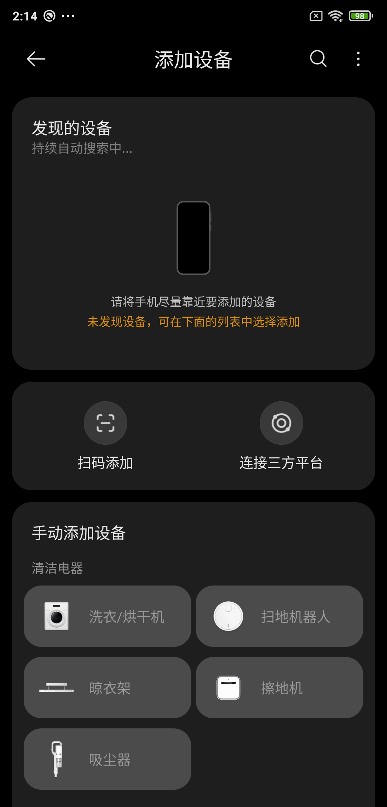
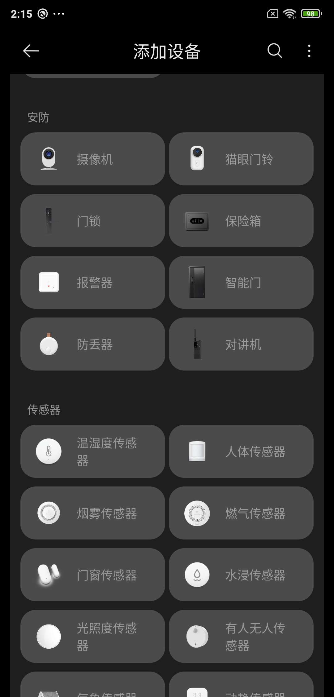

- 功能：
  1. **发现的设备**：BLE/广播自动搜索（持续自动搜索中）
  2. **扫码添加 / 连接三方平台**
  3. **手动添加设备**（分类）：
     - 清洁电器：洗衣机/烘干机、扫地机器人、晾衣架、擦地机、吸尘器
     - 安防：摄像机、猫眼门铃、门锁、保险箱、报警器、智能门、防丢器、对讲机
     - 传感器：温湿度、人体、烟雾、燃气、门窗、水浸、光照度、有人无人…
- 接口：配网流程（BLE/MiOT 快连）、`/v2/home/device_list_page` 刷新

#### 设备插件页（服务端下发，App 本体不含 UI）

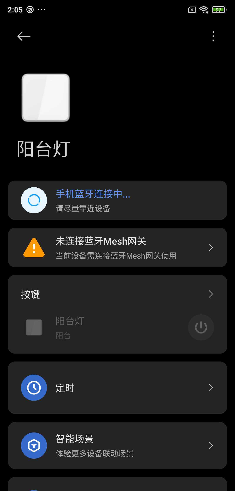
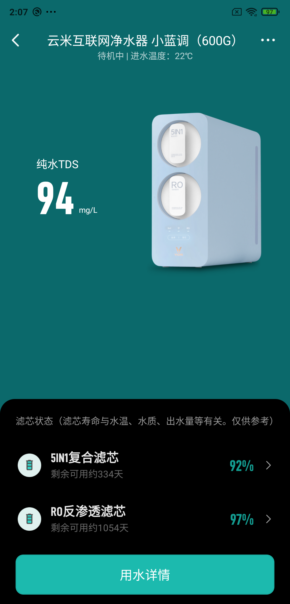


- 承载 Activity：`com.xiaomi.smarthome.framework.plugin.rn.PluginRNActivity`（React Native）等
- **内容 = 米家插件服务端下发**（插件包 RN bundle/小程序），App 只做宿主
- 功能举例：阳台灯（蓝牙 Mesh 连接状态、按键开关、定时、智能场景、日志、传统样式）；净水器（纯水TDS 94mg/L、进水温度、5IN1滤芯92%/RO滤芯97%寿命、用水详情、滤芯购买）
- **鸿蒙重写时此类页面走「插件下发数据 + 自绘」或内嵌 Web 方案，不逆向 UI 本体**

---

### 3.3 [智能] 场景页

#### 探索 Tab

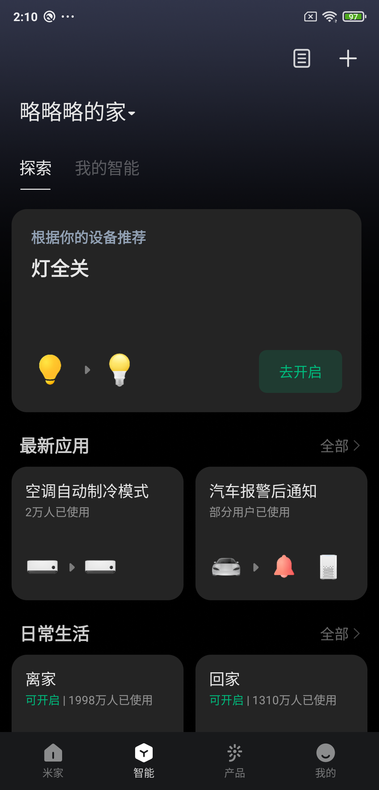

- 结构：探索 | 我的智能 双 Tab + 右上（日志 + 添加）
- 内容：
  - **根据你的设备推荐**：「灯全关」卡（💡→💡，「去开启」按钮）
  - **最新应用**：空调自动制冷模式（2万人已使用）、汽车报警后通知
  - **日常生活**：离家（可开启|1998万人已使用）、回家（可开启|1310万人已使用）
- 接口：场景市场列表（推荐/最新/日常，服务端分类）

#### 我的智能 Tab

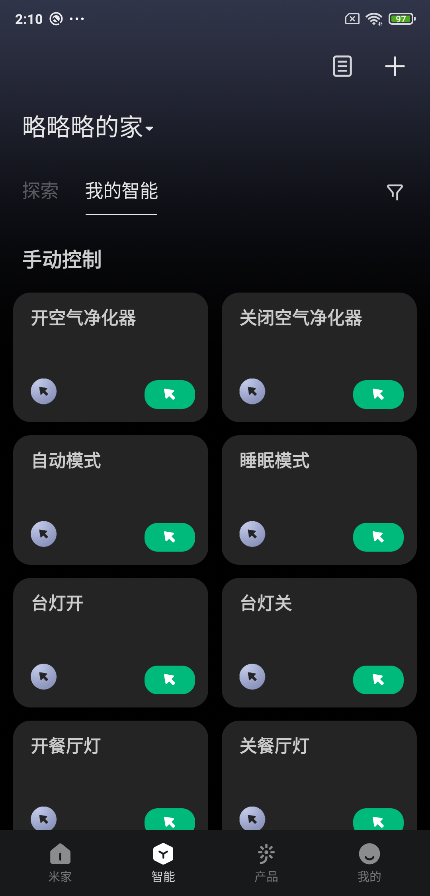
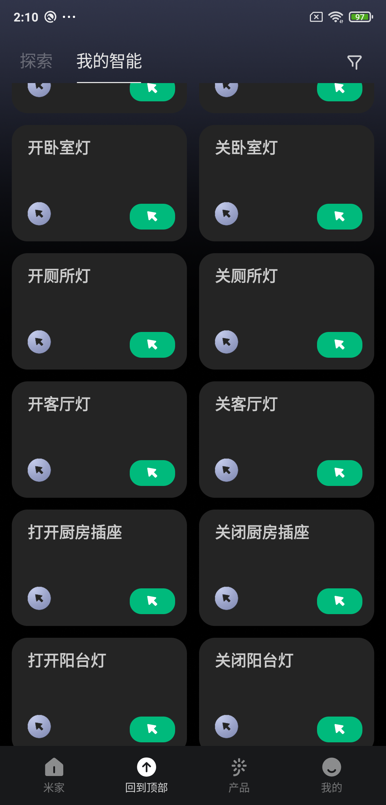
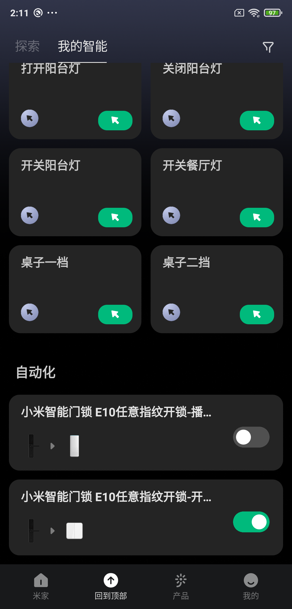

- **手动控制**（一键执行场景卡，点卡片下发）：
  - 开/关空气净化器、自动模式、睡眠模式
  - 台灯开/关、开/关餐厅灯、开/关卧室灯、开/关厕所灯、开/关客厅灯
  - 打开/关闭厨房插座、打开/关闭阳台灯、开关阳台灯、开关餐厅灯
  - 桌子一档、桌子二档（升降桌档位）
  - 每卡右下角绿色箭头 = 执行按钮
- **自动化**（条件触发，带启停开关）：
  - 小米智能门锁 E10 任意指纹开锁 → 播…（门锁指纹联动，开关关闭）
  - 小米智能门锁 E10 任意指纹开锁 → 开…（开关打开）
- 接口：
  - 场景列表：`/v2/home/scene/list`（或 gethome_merged 内 scenes）
  - 执行手动场景：`POST /v2/home/scene/start`（scene_id/tap）
  - 自动化启停：`/v2/home/scene/enable`（(enable/disable, scene_id)）
- 执行的本质：场景内动作逐条转为设备 rpc（`/home/rpc/{did}`）

---

### 3.4 [产品] 商城发现页

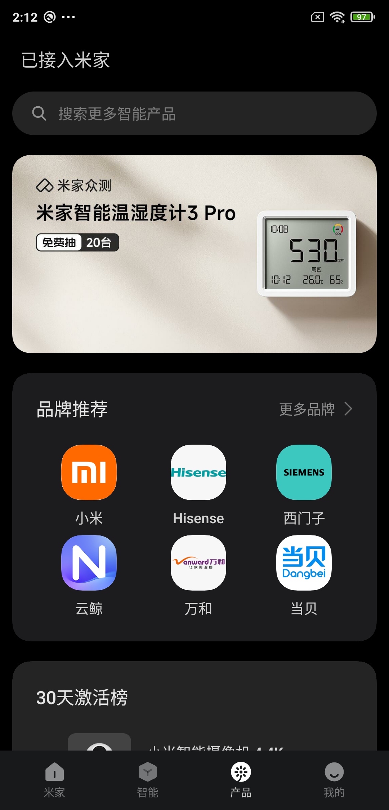

- 结构：「已接入米家」+ 搜索框 + 运营位 + 分类内容
- 内容：米家众测（温湿度计3 Pro 免费抽）、品牌推荐（小米/Hisense/西门子/云鲸/万和/当贝）、30天激活榜
- 接口：商城内容聚合（服务端运营配置）
- 该 Tab 为纯运营页，鸿蒙版可降级为 WebView 或隐藏

---

### 3.5 [我的] 个人中心

#### 我的主页

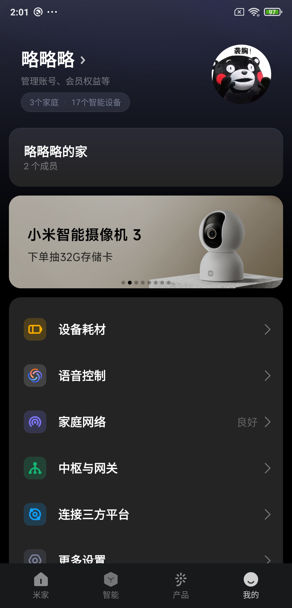
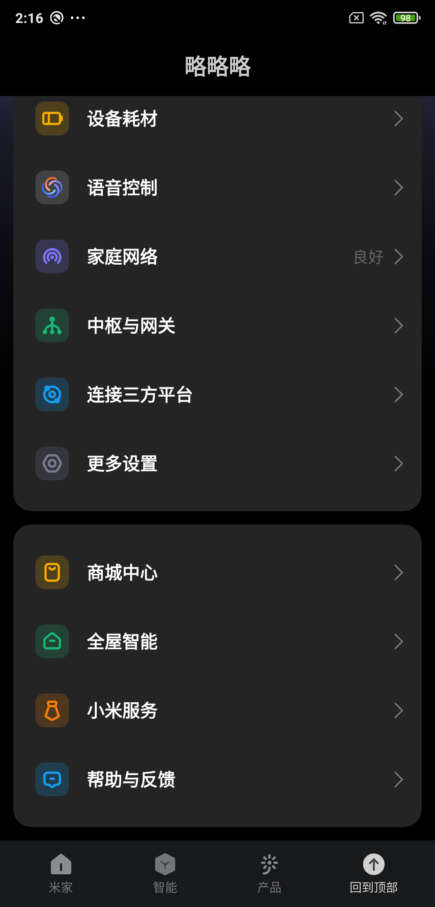

- 结构：
  - 用户卡：略略略 >（管理账号、会员权益等）+ 头像 + 「3个家庭 | 17个智能设备」
  - 家庭卡：略略略的家（2个成员）+ 成员头像 + 「+」邀请
  - 运营 Banner：小米智能摄像机 3（轮播）
  - 菜单组一：设备耗材 / 语音控制 / 家庭网络（良好）/ 中枢与网关 / 连接三方平台 / 更多设置
  - 菜单组二：商城中心 / 全屋智能 / 小米服务 / 帮助与反馈
- 接口：用户信息（passport profile）、家庭统计（gethome_merged 聚合）

#### 家庭管理（CreateHouseActivity）

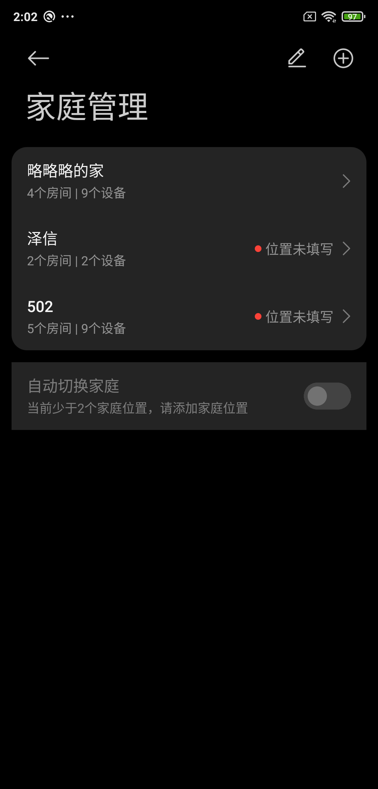

- 真实数据：3 个家庭
  - 略略略的家：4个房间 | 9个设备
  - 泽信：2个房间 | 2个设备（位置未填写）
  - 502：5个房间 | 9个设备（位置未填写）
- 自动切换家庭开关（当前少于2个家庭位置，请添加家庭位置）

#### 家庭详情

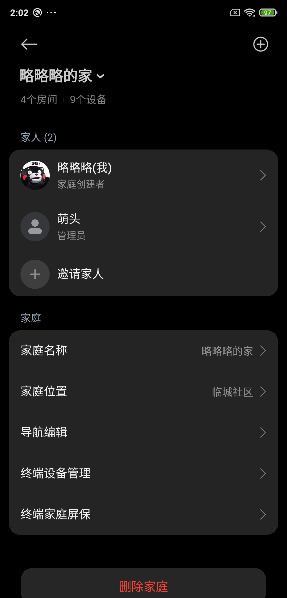

- 结构：家庭名（4个房间|9个设备）→ 家人(2)：略略略(我)家庭创建者、萌头管理员、邀请家人 → 家庭设置：家庭名称 / 家庭位置（临城社区）/ 导航编辑 / 终端设备管理 / 终端家庭屏保 / 删除家庭
- 接口：家庭 CRUD（homeroom 系列）、成员管理（share/family）

#### 更多设置（AboutActivity）

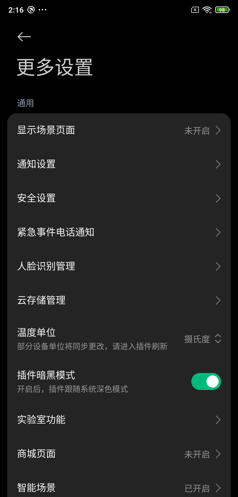
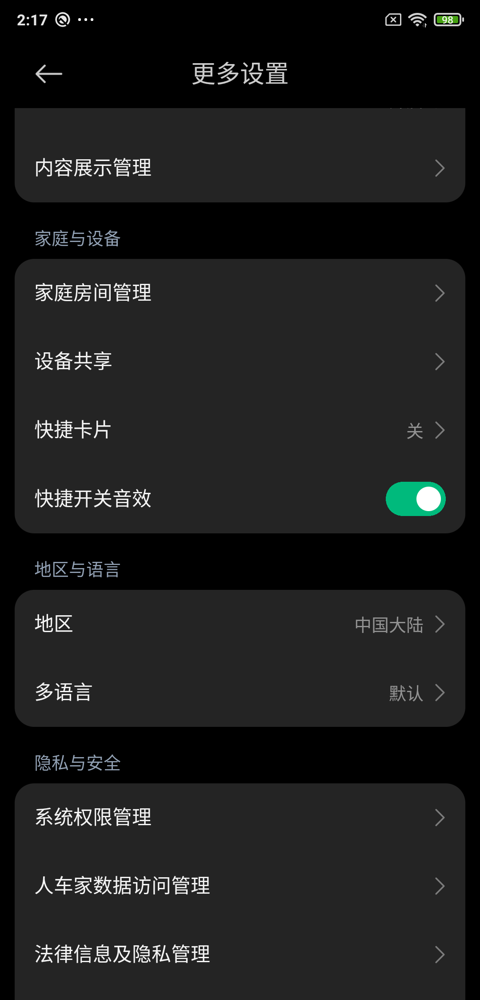
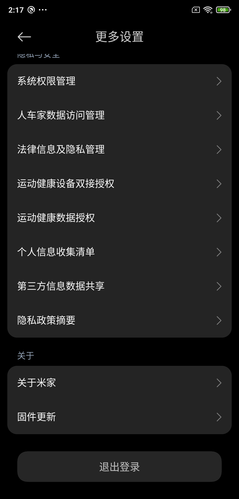

- **通用**：显示场景页面（未开启）、通知设置、安全设置、紧急事件电话通知、人脸识别管理、云存储管理、温度单位（摄氏度）、插件暗黑模式（开）、实验室功能、商城页面（未开启）、智能场景（已开启）
- **家庭与设备**：家庭房间管理、设备共享、快捷卡片（关）、快捷开关音效（开）
- **地区与语言**：地区（中国大陆）、多语言（默认）
- **隐私与安全**：系统权限管理、人车家数据访问管理、法律信息及隐私管理、运动健康设备双接授权、运动健康数据授权、个人信息收集清单、第三方信息数据共享、隐私政策摘要
- **关于**：关于米家、固件更新
- **退出登录**

#### 关于米家（AboutMijiaActivity）

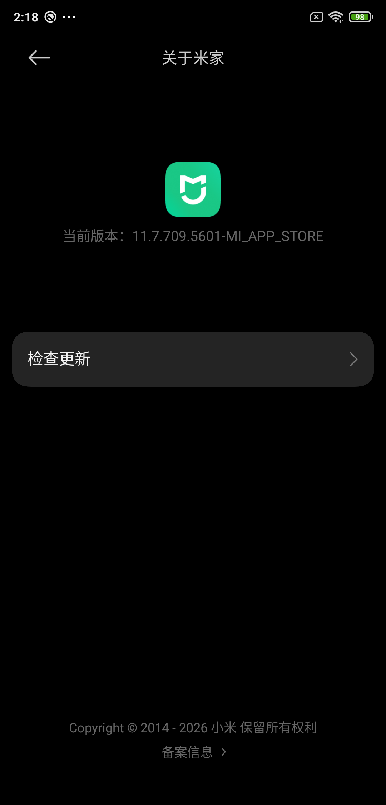

- 当前版本：**11.7.709.5601-MI_APP_STORE**；检查更新；Copyright © 2014-2026 小米

---

## 4. 云接口协议（jadx 逆向结论）

### 4.1 域名选择（`_m_j/ir7.java`）

| 地区 | API 域名 | sid | Cookie 域 |
|---|---|---|---|
| 中国大陆（CN） | `https://api.mijia.tech` | `xiaomiio` | `.io.mi.com` |
| 测试（st） | `https://{region}.api.mijia.tech` | `mijia-test` | `.mijia.tech` |
| 海外 | `https://{region}.api.io.mi.com` | `mijia` | `.mijia.tech` |

> ⚠️ 关键修正：**大陆走 `api.mijia.tech`**（不是 api.io.mi.com！），请求 URL 形如 `https://api.mijia.tech/app//v2/home/device_list_page`（`/app/` + 路径，存在双斜杠写法）。

### 4.2 登录（小米账号 SDK，未变）

1. `GET https://account.xiaomi.com/pass/serviceLogin?sid=xiaomiio&_json=true` → `_sign`/`qs`/`callback`
2. `POST /pass/serviceLoginAuth2`（user、hash=MD5(pwd)、sid、_sign、qs、callback）→ `ssecurity`、`userId`、`location`、`timeDiff`
3. `GET location`（跟随 302）→ Set-Cookie：`serviceToken`、`userId`、`cUserId`、`passToken`

二次验证：`/pass/serviceLoginAuth2` 返回 `notificationUrl`（sts 安全验证页），须在 WebView 完成并保持同一 Cookie 会话。

### 4.3 请求签名（RC4 加密协议，`_m_j/mje.OooO0oo` + `_m_j/m52`）

```
请求头:
  MIOT-ENCRYPT-ALGORITHM: ENCRYPT-RC4
  Accept-Encoding: identity
  Cookie: userId=..; cUserId=..; yetAnotherServiceToken=..; serviceToken=..;
          channel=MI_APP_STORE; countryCode=CN; PassportDeviceId=..;
          locale=zh_CN; timezone=GMT+08:00; is_daylight=0; dst_offset=28800000

参数构造（以 data={json} 为例）:
  _nonce      = base64( writeLong(8字节随机) + writeInt((now + timeDiff)/60000) )
  signedNonce = base64( SHA256( b64decode(ssecurity) || b64decode(_nonce) ) )
  rc4Key      = b64decode(signedNonce)          # 32字节，RC4 先丢弃 1024 字节流
  rc4_hash__  = b64( SHA1("POST&" + path + "&data=<明文>&" + signedNonce) )
  data'       = b64( RC4(rc4Key, data明文) )
  rc4_hash__' = b64( RC4(rc4Key, rc4_hash__) )
  signature   = b64( SHA1("POST&" + path + "&data=<密文>&rc4_hash__=<密文>&" + signedNonce) )

最终 POST 表单: data=<密文> & rc4_hash__=<密文> & signature=.. & _nonce=.. & ssecurity=..

响应: RC4(rc4Key) 解密后为 JSON
```

- SHA1/SHA256 均为标准库；RC4 为标准 KSA+PRGA + drop-1024（`_m_j/qg0` + `_m_j/e3a`）
- path 参与签名时用 URL 编码后的路径（`Uri.parse(path).getEncodedPath()`）
- `timeDiff` 来自登录响应（通常 0）

### 4.4 核心业务接口（真实路径，自 DeviceApi.java / SmartHomeRc4Manager.java 逆向）

| 功能 | 方法 | 路径 | 参数（data 内 JSON） |
|---|---|---|---|
| 设备列表（分页） | POST | `/v2/home/device_list_page` | `{}` 首页；`{"start_did":"..."}` 翻页；`{"dids":[...]}` 按批查询 |
| 设备详情 | POST | `/v2/home/device_list_page` | `{"dids":["xxx"]}` |
| 家庭房间（旧版） | POST | `/v2/homeroom/gethome_merged` | `{fg:true,fetch_share:true,fetch_share_dev:true,limit:300,app_ver:7}` |
| 家庭房间（mico通道） | GET | `/homeroom/gethome` | `{"fetch_share_dev":true}` |
| 远程控制 | POST | `/home/rpc/{did}` | `{"method":"miIO.xx","params":{...}}`（rnAsyncRemote） |
| 批量属性设置 | POST | `/v2/device/set_props` | props 数组 |

**设备列表响应结构（顶层，无 result 包裹）：**

```json
{
  "list": [ { "did": "...", "token": "...", "name": "...", "model": "...",
              "localip": "...", "isOnline": true, "roomid": ..., ... } ],
  "has_more": false,
  "next_start_did": ""
}
```

### 4.5 miIO 局域网协议（未变）

- UDP 54321，AES-128-CBC；key=MD5(token)，IV=MD5(key+token)
- `{"id":1,"method":"get_prop","params":...}`，握手 `miIO.info`

---

## 5. 鸿蒙重写对照表（结论）

| 原版页面 | 重写方案 |
|---|---|
| 启动/隐私/服务器选择 | 原生自绘（本地逻辑） |
| 首页（房间Tab+设备卡） | 原生：`device_list_page` + `gethome_merged` 真数据 |
| 房间列表弹层/房间编辑 | 原生自绘，配置本地+云端同步 |
| 设备插件页 | **服务端下发内容**——用 Web 容器加载插件或按 MIoT spec 自绘基础控制 |
| 智能页（探索/我的智能） | 原生列表 + `/v2/home/scene/*` |
| 产品/商城 | 可降级 WebView |
| 我的/设置/家庭管理 | 原生自绘 |
| 消息中心 | 原生列表 + 消息接口 |
| 添加设备 | 首期建议走「扫码添加/已有设备」，配网流程复杂可后置 |
| 智能助手 | 接 AI 对话流式接口 |

## 6. 附录

- `activities_list.txt`：com.xiaomi.smarthome 全部 682 个 Activity 类名清单
- `screenshots/`：35 张真机实拍截图（1080×2248，小米 8）
